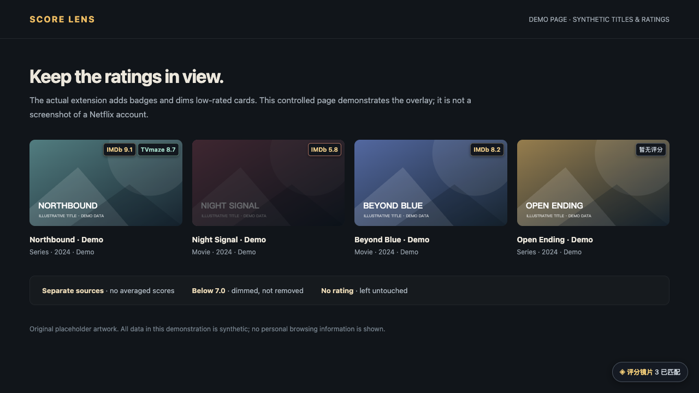
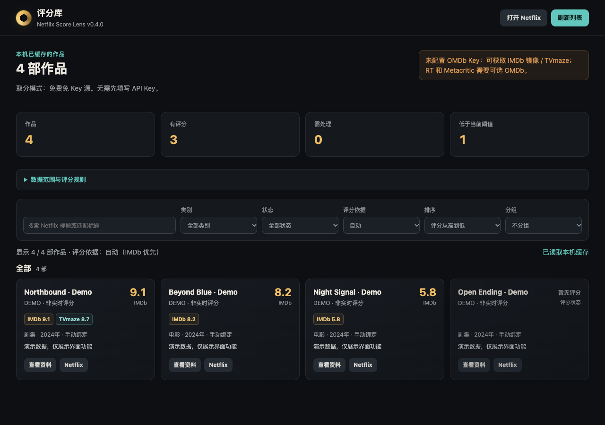

# Netflix Score Lens

**English** | [简体中文](README.zh-CN.md)

[](https://github.com/cyhhao/netflix-score-lens/actions/workflows/ci.yml)
[](LICENSE)

**Keep the ratings in view. Find your next watch with less tab-switching.**

A Chrome extension that adds rating badges to Netflix cards, dims titles below your preferred score, and lets you explore previously matched titles in a separate local library. Free-source mode works without an API key; an optional OMDb key adds more rating sources.

[Download the latest release](https://github.com/cyhhao/netflix-score-lens/releases) · [Privacy policy](https://cyhhao.github.io/netflix-score-lens/privacy.html) · [Report an issue](https://github.com/cyhhao/netflix-score-lens/issues)

> **Status:** Open source and available for manual unpacked installation. **Not yet listed in the Chrome Web Store.** Store materials are prepared, but storage security, data disclosures, provider permissions and final acceptance remain release gates. See the [store checklist](docs/chrome-web-store.md) (Chinese).
>
> The extension's current UI is **Simplified Chinese**. This English README does not imply an English-localized app. The project is independent and not affiliated with Netflix or any rating provider.

## Product screenshots

These captures use the **real extension UI with clearly labelled synthetic titles and scores**. They contain no personal account, browsing history or API key. The overlay capture uses a controlled demonstration page, **not Netflix's live website**. [How the screenshots are generated](docs/screenshots/README.md).

### Ratings on cards, low scores dimmed

Keep sources distinct, dim scores below your threshold, and leave titles with missing ratings untouched. The badges and dimming below are produced by the actual content script.



### A local library you can open independently

Search previously matched titles, select a rating source, sort or group results, and inspect matching details without keeping a Netflix tab open.



### Controls within reach

Change the score threshold, dimming strength and hover-to-reveal behavior from the popup. Settings take effect on Netflix without reloading the page.


## Features

- **Clearly labelled scores:** IMDb ratings mirrored by Cinemeta, TVmaze's independent show ratings, and optional OMDb-provided IMDb / Rotten Tomatoes / Metacritic scores. Each source keeps its native scale.
- **Adjustable low-score dimming:** Choose the source, threshold and opacity. Reveal a dimmed card on hover. Missing or unconfirmed scores are never treated as zero.
- **Conservative matching:** Netflix IDs identify titles; localized names, year and movie/series type help resolve IMDb IDs. Chinese, Japanese and Korean titles use IMDb suggestion/alias search first. Uncertain matches remain open for confirmation.
- **Manual corrections:** Search by title, year, type, IMDb ID or link, then explicitly bind the correct result or restore automatic matching.
- **Independent local library:** Search and filter by movie/series or status; sort by score, title, year or update time; group by type, status or score band; inspect sources and open the Netflix title.
- **Visible status:** Distinguish request failures, missing scores, quota/key issues and ambiguous matches. Pause, retry and test sources explicitly.

## Install

1. Download `netflix-score-lens-<version>-unpacked.zip` from [Releases](https://github.com/cyhhao/netflix-score-lens/releases) and extract it.
2. Open `chrome://extensions`, enable **Developer mode**, then click **Load unpacked**.
3. Select the extracted `netflix-score-lens` folder containing `manifest.json`. Keep this folder: Chrome loads the extension from it.
4. Sign in to Netflix and refresh a browsing page. Free sources work without entering an API key.

Alternatively, clone this repository and load its root folder directly. **Node.js and npm are not needed to run the extension.**

For updates, keep the original installation folder, replace its files, click **Reload** on the extension's management card, then refresh Netflix. Do not uninstall first just to update: that would remove local extension data.

## How ratings work

| Configuration | Automatic score lookup |
|---|---|
| No API key | Cinemeta's IMDb mirror; series also try TVmaze's separate rating |
| Your OMDb key, supplementation enabled | Free sources plus OMDb for the same IMDb ID; OMDb's IMDb score takes precedence when both return one |
| Key saved, **free sources only** selected | No automatic OMDb lookup; explicit source-health testing still checks the saved key |

Valid cache entries are reused first. Successful scores are normally reusable for up to seven days. An OMDb failure does not discard free-source scores.

**Auto** chooses the first available source in this order: **IMDb → TVmaze → Rotten Tomatoes → Metacritic**. It does not average scores or pick the highest one. An explicitly selected source is never silently replaced by another when its score is missing.

## Limitations

- This is not an official Netflix↔IMDb mapping. Remakes, similar names and localized titles may need manual correction; Netflix may not expose an English name or a complete year.
- Cinemeta is a mirror, not the official IMDb rating API. IMDb's suggestion endpoint has no public stability commitment. Providers may rate-limit, change access or change terms.
- Not every title has every score, and mirrored ratings may be stale.
- The library is a **view of up to 600 local cached query variants**, not the complete Netflix catalog or a permanent watchlist. Cache clearing, key changes, provider-mode changes and eviction can remove entries.
- Categories currently mean **movie / series**, not genres such as action or mystery. Check regional availability on Netflix itself.
- The unpacked version does not download updates automatically. Netflix DOM or API changes can require maintenance.

## Privacy and data sources

[Privacy policy](https://cyhhao.github.io/netflix-score-lens/privacy.html) · [Third-party notices](THIRD_PARTY_NOTICES.md) · [Security policy](SECURITY.md)

The extension reads the title name, Netflix ID, available year and type needed for matching. **Title names or IMDb IDs are sent to the relevant rating providers**, which can see the requesting IP address. An optional OMDb key is sent only to OMDb. There is no project-operated collection backend, advertising, analytics SDK, account registration or browser-history permission. The extension does not read Netflix passwords or cookies.

**Local storage does not mean encrypted storage.** Settings, encountered-title caches, manual bindings and the optional key currently use Chrome's local extension storage. Content scripts cannot read the credentials, but this is not an OS password vault and does not implement application-level encryption at rest. Someone with access to the browser profile or device may still read it. Do not enter another service's password or a high-value credential.

The MIT license covers original project code, not third-party databases, trademarks, posters or API access rights. TVmaze data retains its CC BY-SA terms and attribution. Other providers' access and redistribution terms still apply.

## Development and testing

Use Node.js 22+ and Python 3. Browser tests use temporary profiles, never your everyday browser data or a real API key.

```bash
npm ci
npm test
npx playwright install chromium
npm run test:browser
npm run package
```

On Linux, install browser dependencies if needed with `npx playwright install --with-deps chromium`. Set `CHROME_PATH` or `CFT_PATH` to use another extension-capable browser executable; never pass a personal profile.

```bash
# Optional: accesses real providers; subject to network, rate limits and coverage.
npm run test:live
PROVIDERS_LIVE=1 node --test tests/providers.test.mjs

# Recreate the README captures using only synthetic data and a disposable browser.
node scripts/readme-screenshots.mjs
```

CI runs unit tests and isolated real-extension checks; third-party uptime is not a deterministic PR requirement. Demo/test data never enters the installation ZIP. [Testing boundaries](docs/testing.md) distinguish fixtures, live API checks and actual Netflix acceptance.

## Packaging and store preparation

`npm run package` uses an explicit file allowlist and writes to `dist/`:

- `*-unpacked.zip`: a user-installable archive with a top-level folder.
- `*-chrome-web-store.zip`: an upload candidate with `manifest.json` at the ZIP root — **not a signed or store-approved build**.
- `SHA256SUMS.txt`: integrity checksums.

The [Chrome Web Store checklist](docs/chrome-web-store.md) (Chinese) covers permissions, disclosures, reviewer instructions and draft materials. Never publish keys, Netflix login credentials or personal browsing screenshots.

## Contributing

[Issues](https://github.com/cyhhao/netflix-score-lens/issues) and pull requests are welcome. Read [CONTRIBUTING.md](CONTRIBUTING.md) first. Use private vulnerability reporting for security issues; never post credentials publicly.

## License

[MIT](LICENSE) — cyhhao and contributors. Netflix, IMDb, Rotten Tomatoes, Metacritic, TVmaze and Stremio are names owned by their respective holders. This project is not affiliated with or endorsed by them.
