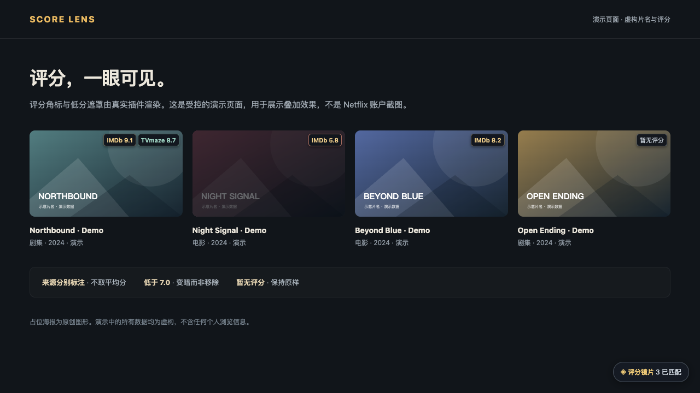
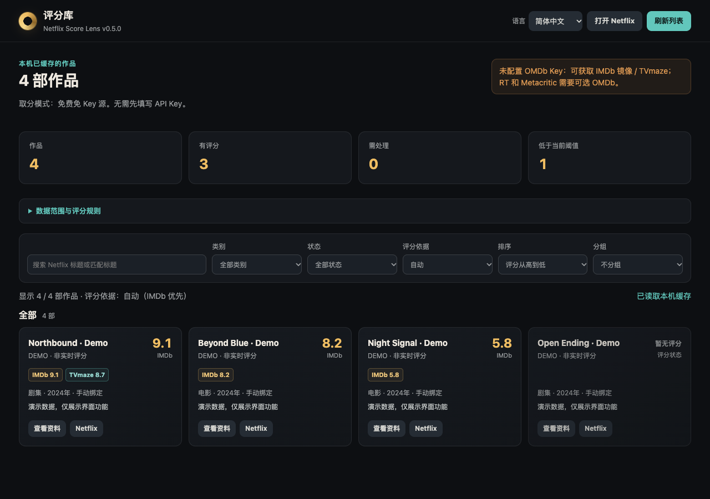
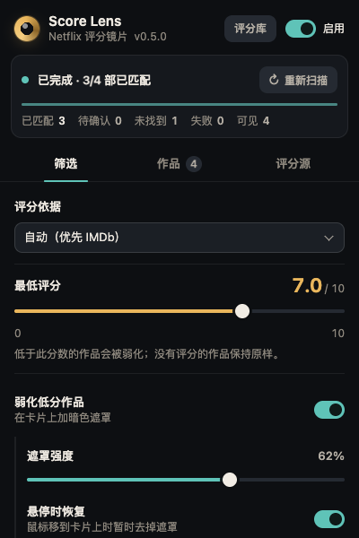

# Netflix Score Lens

**简体中文** | [English](README.en.md)

[](https://github.com/cyhhao/netflix-score-lens/actions/workflows/ci.yml)
[](LICENSE)

**评分一眼可见，少切几次标签页，更快找到下一部想看的作品。**

一个 Chrome 扩展：在 Netflix 卡片上显示评分角标，用可调遮罩弱化低于你设定分数的作品，并在独立的本机评分库中浏览已经匹配过的作品。免费源模式无需 API Key；可选的 OMDb Key 可补充更多评分来源。

[下载最新版本](https://github.com/cyhhao/netflix-score-lens/releases) · [隐私政策](https://cyhhao.github.io/netflix-score-lens/privacy.html) · [反馈问题](https://github.com/cyhhao/netflix-score-lens/issues)

> **当前状态：开源，可手动加载已解压的扩展使用；尚未在 Chrome Web Store 上架。**
> 商店材料及专用 ZIP 已准备，但凭据与标题缓存的静态存储安全、数据披露、第三方数据使用范围及最终环境验收仍是发布门槛，不能把 ZIP 生成成功当成审核通过。见 [上架清单](docs/chrome-web-store.md)。
>
> 插件默认跟随浏览器语言（English 或简体中文），也可在弹窗和评分库中手动切换；匹配支持本地化标题。本项目独立开发，与 Netflix 或任何评分提供方无关联。

## 产品展示

以下截图使用**真实插件界面和明确标注的演示片名／评分**，不含个人账号、浏览记录或 Key。角标截图来自受控的演示卡片页，**不是 Netflix 真实网站截图**。[截图生成与数据说明](docs/screenshots/README.md)。

### 评分直接上卡片，低分内容自动弱化

来源分别标注，低于阈值的作品变暗，没有评分的作品保持原样。下图的角标和遮罩由插件真实内容脚本渲染。



### 不打开 Netflix，也能浏览本机评分库

搜索已经匹配的作品，切换评分来源，排序、分组，并查看匹配依据与来源资料。



### 在弹窗里随手调整

评分阈值、遮罩强度、悬停恢复都可直接控制，设置即时作用于 Netflix，无需刷新页面。



## 功能

- **评分角标**：Cinemeta 镜像的 IMDb 评分、TVmaze 独立剧集评分，以及可选 OMDb 提供的 IMDb / 烂番茄 / Metacritic。每个来源分别标注并保留原始尺度。
- **低分弱化**：选择评分口径、阈值和遮罩强度；支持悬停恢复。缺失或待确认评分不会当成 0 分。
- **保守匹配**：Netflix ID 标识作品；当初次片名检索不足以确认时，按需以匿名、无 Cookie 的请求读取该 ID 的英文公开展示名，再用精确年份和电影/剧集类型核对 IMDb 候选。只在唯一证据成立时自动确认，冲突仍要求手动确认；不抓取全量目录、不保存 HTML。
- **手动纠错**：在弹窗「作品」中搜索原名、年份、类型或 IMDb ID/链接，明确绑定正确结果或恢复自动匹配。
- **独立评分库**：从弹窗顶部进入，无需保持 Netflix 标签页打开。支持搜索、电影/剧集和状态筛选，按评分/标题/年份/更新时间排序，按类别/状态/评分段分组，查看来源资料并打开 Netflix 作品页。
- **状态可见**：请求失败、无评分、额度/Key 问题、匹配歧义分别提示；支持暂停、重试和来源验证。

## 安装

1. 从 [Releases](https://github.com/cyhhao/netflix-score-lens/releases) 下载 `netflix-score-lens-<版本>-unpacked.zip` 并解压。
2. 打开 `chrome://extensions`，开启「开发者模式」，点击「加载已解压的扩展程序」。
3. 选择包含 `manifest.json` 的 `netflix-score-lens` 目录。保留此目录，Chrome 持续从中读取扩展。
4. 登录 Netflix，刷新浏览页。默认免费源即可工作，不必先配置 Key。

也可克隆本仓库后直接加载仓库根目录。**运行扩展本身无需 Node.js 或 npm。**

更新时保留原安装目录并替换其中文件，在扩展管理页点击「重新加载」，再刷新 Netflix。不要为了更新先移除扩展，以免丢失本机扩展数据。

## 评分如何获取

| 配置 | 自动取分 |
|---|---|
| 无 Key | Cinemeta 的 IMDb 镜像；剧集另尝试 TVmaze 的独立评分 |
| 自带 OMDb Key，并开启「用 OMDb 补充评分」 | 免费源 + 同一 IMDb ID 的 OMDb 结果；两者都有 IMDb 分数时以 OMDb 为准 |
| 已保存 Key，但关闭「用 OMDb 补充评分」 | 自动取分不使用 OMDb；手动「实时验证」仍会测试已保存的 Key |

优先读取有效缓存；成功取得的评分通常最多复用 7 天。OMDb 失败不会丢弃免费源评分。

**自动**口径按 **IMDb → TVmaze → 烂番茄 → Metacritic** 的顺序选第一个可用值，不求平均、不取最高分。明确选择某一来源后，该来源缺失时不会偷偷换成另一来源。

## 局限

- 不是官方 Netflix↔IMDb 映射；翻拍、同名和译名仍可能需要手动确认。补充取得的是**英文展示名**，不一定是原始语言片名。公开页可能不可用，年份/类型也可能缺失；不据此强行猜测。
- Cinemeta 是镜像，不是 IMDb 官方评分 API；IMDb 建议接口未公开承诺稳定性。第三方可能限流、改变访问方式或条款。
- 不保证每部作品都有每种评分，镜像评分也可能不是最新。
- 评分库是**最多 600 个查询版本的本机缓存视图**，不是全量 Netflix 目录或永久片单。清缓存、更换 Key、切换取分模式和容量淘汰都会移除条目。
- 类别目前指**电影 / 剧集**，不含动作、悬疑等题材标签。地区可用性请在 Netflix 上核对。
- 已解压加载的版本不会自动下载更新；Netflix DOM 或 API 变动可能需要适配。

## 隐私与数据来源

[隐私政策](https://cyhhao.github.io/netflix-score-lens/privacy.html) · [第三方声明](THIRD_PARTY_NOTICES.md) · [安全说明](SECURITY.md)

扩展只读取匹配所需的标题、Netflix 作品 ID、可用的年份和类型。**片名或 IMDb ID 会发送给相应评分服务；当需要英文展示名补充时，Netflix 作品 ID 还会发送给 Netflix 的公开标题页**，请求不带 Netflix Cookie。服务可看到请求来源 IP。可选 OMDb Key 仅发送给 OMDb。没有项目自有的收集后端、广告、分析 SDK、账户注册或浏览历史权限，不读取 Netflix 密码或 Cookie。

**本地存储不等于加密存储。** 目前设置、已遇到作品的缓存、手动绑定和可选 Key 保存在 Chrome 扩展本地存储；内容脚本无权读取凭据，但这不是操作系统密码库，也未实现应用层静态加密。能访问本机或浏览器配置的人仍可能读取它们。不要填写其他服务的密码或高价值凭据。

MIT 许可只涵盖本项目原创代码，不涵盖第三方数据库、商标、海报或 API 使用权。TVmaze 数据保留其 CC BY-SA 许可及来源归属；其他服务的访问和再分发权仍需遵循各自条款。

## 开发与测试

需要 Node.js 22+ 和 Python 3。浏览器测试使用临时配置，绝不使用日常浏览器资料或真实 API Key。

```bash
npm ci
npm test
npx playwright install chromium
npm run test:browser
npm run package
```

Linux 如缺浏览器系统依赖，可运行 `npx playwright install --with-deps chromium`。可通过 `CHROME_PATH` 或 `CFT_PATH` 指定其他可加载扩展的浏览器可执行文件；不要传入个人 profile。

```bash
# 可选：会访问真实评分服务，可能受网络、限流与覆盖率影响
npm run test:live
PROVIDERS_LIVE=1 node --test tests/providers.test.mjs

# 只用演示数据和临时浏览器重新生成 README 截图（英文 / 中文）
node scripts/readme-screenshots.mjs en
node scripts/readme-screenshots.mjs zh-CN
```

CI 运行单元测试和隔离的真实扩展测试，不把第三方服务的可用性当作每次 PR 的确定性要求。演示/测试数据不会进入安装包。[验证范围](docs/testing.md)明确区分 fixture、真实 API 检查和实际 Netflix 页面验收。

## 打包与上架准备

`npm run package` 使用显式文件白名单，输出到 `dist/`：

- `*-unpacked.zip`：供用户解压安装，含顶层目录。
- `*-chrome-web-store.zip`：`manifest.json` 位于 ZIP 根部的上传候选包——**不是已签名或已通过商店审核的版本**。
- `SHA256SUMS.txt`：完整性校验。

[Chrome Web Store 上架清单](docs/chrome-web-store.md)涵盖权限用途、数据披露、审核测试说明及材料草案。不得公开 Key、Netflix 登录资料或个人浏览截图。

## 贡献

欢迎 [Issue](https://github.com/cyhhao/netflix-score-lens/issues) 与 Pull Request。请先阅读 [CONTRIBUTING.md](CONTRIBUTING.md)。安全问题请使用私密漏洞报告，不要公开贴出凭据。

## License

[MIT](LICENSE) — cyhhao and contributors. Netflix、IMDb、Rotten Tomatoes、Metacritic、TVmaze、Stremio 等名称属于各自权利人；本项目与它们没有关联，也未获得其背书。
